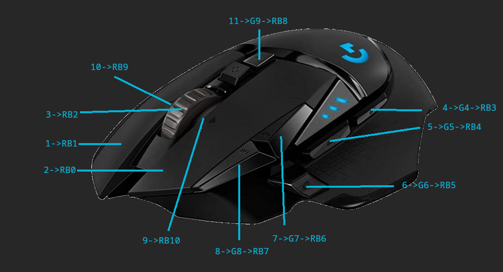

# G502 button map

The annotated diagram shows each button with its manual number, G-name, and the
**ratbag index** used by LinGHub and the legacy scripts in `utils/`. The
unannotated photo is at `images/g502-photo.png`.

> Note: ratbag numbers the buttons differently from the manual. The tilt wheel
> and profile button are the main differences — check the table, not the
> manual's numbering, when editing profiles.

<table>
  <tr>
    <td valign="top">
      
    </td>
    <td valign="top">

| Manual # | Button | G-name | ratbag index | Notes |
| --- | --- | --- | --- | --- |
| 1 | Left click | — | `0` | |
| 2 | Right click | — | `1` | |
| 3 | Wheel click | — | `2` | |
| 4 | Back | G4 | `3` | rear thumb button |
| 5 | Forward | G5 | `4` | forward thumb button |
| 6 | DPI Shift (sniper) | G6 | `5` | thumb rest; hold for temporary DPI |
| 7 | DPI Down | G7 | `6` | below wheel |
| 8 | DPI Up | G8 | `7` | below G7 |
| 9 | Scroll left | — | `10` | wheel tilt left |
| 10 | Scroll right | — | `9` | wheel tilt right |
| 11 | Profile select | G9 | `8` | behind wheel |
| 12 | Wheel mode shift | — | n/a | not programmable |

    </td>
  </tr>
</table>

## Supported variants

libratbag defines seven G502 variants. LinGHub identifies the variant by USB ID
for display purposes only; every capability is read from the device at runtime.

| Variant | USB IDs | Quirk |
| --- | --- | --- |
| Proteus Core | `046d:c07d` | — |
| Proteus Spectrum | `046d:c332` | — |
| Hero | `046d:c08b` | — |
| Hero Wireless (Lightspeed) | `046d:407f`, `046d:c08d` | — |
| G502 X | `046d:c099` | `INDEX_OFFSET` |
| G502 X Wireless | `046d:c098`, `046d:409f` | `INDEX_OFFSET` |
| G502 X PLUS | `046d:4099`, `046d:c095` | `G502X_PLUS`, `INDEX_OFFSET` |

`INDEX_OFFSET` means profile indices are 1-based on that device. `G502X_PLUS`
means the LED lives in the second slot.
